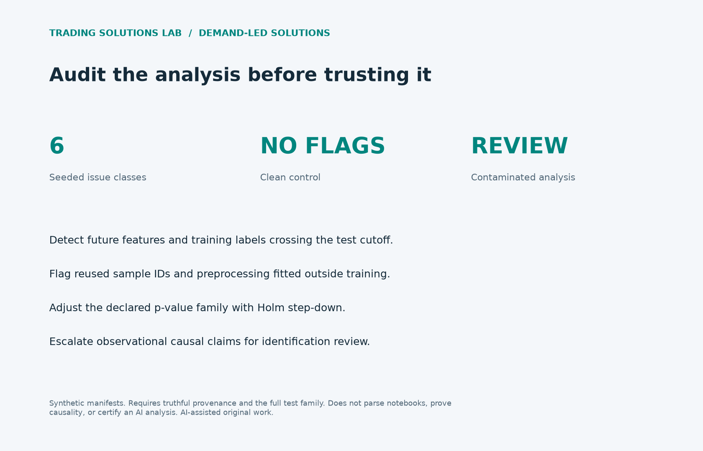

# AI analysis review harness

Check declared evidence before accepting an AI-generated analysis.



## Executed result

The clean fixture has no flags. The contaminated fixture produces these six distinct issue classes:

- CAUSAL_CLAIM_REQUIRES_IDENTIFICATION_REVIEW
- FEATURE_UNAVAILABLE_AT_DECISION
- PREPROCESSING_FIT_OUTSIDE_TRAIN
- SAMPLE_ID_REUSED
- SIGNIFICANCE_NOT_RETAINED_AFTER_HOLM
- TRAIN_LABEL_OVERLAPS_TEST

The three declared raw p-values (0.01, 0.03, 0.04) become (0.03, 0.06, 0.06) after Holm adjustment; only the first remains significant at 0.05. This illustrates family-wise adjustment, not proof of p-hacking.

## Reproduce and adapt

```sh
python -m unittest test_demand_solutions -v
python run_demand_solutions.py --output /tmp/demand-evidence
```

[Implementation](../../solutions/analysis_review/) · [Design and public demand references](../../solutions/README.md) · [Results JSON](results.json) · [Standalone HTML report](report.html)

## Scope

Checks supplied manifests only; it cannot discover undisclosed trials or certify causal identification. Original AI-assisted portfolio work; no client source, account data, or proprietary strategy is included.
