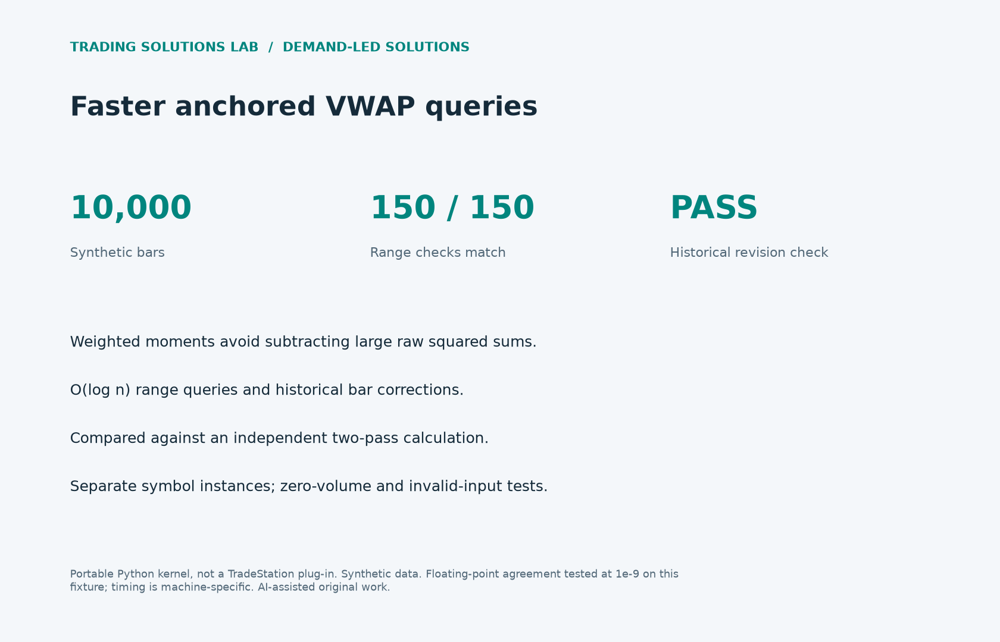

# Anchored VWAP performance

Compute many anchored VWAP ranges without rescanning all history.



## Executed result

150/150 ranges matched an independent two-pass reference at 1e-9 tolerance. The historical revision check also passed.

On this Darwin arm64 / Python 3.14.8 run, median query times were 0.117640s for rescanning and 0.000738s for the tree (159.4x). Tree construction took 0.012966s separately. These are 150 queries over 10,000 synthetic bars, median of three runs, seed 291026. This is a kernel microbenchmark, not end-to-end platform performance.

[Raw timing methodology and results](benchmark.json).

## Reproduce and adapt

```sh
python -m unittest test_demand_solutions -v
python run_demand_solutions.py --output /tmp/demand-evidence
```

[Implementation](../../solutions/vwap/) · [Design and public demand references](../../solutions/README.md) · [Results JSON](results.json) · [Standalone HTML report](report.html)

## Scope

TradeStation / EasyLanguage integration, UI latency and live feeds have not been tested. Original AI-assisted portfolio work; no client source, account data, or proprietary strategy is included.
