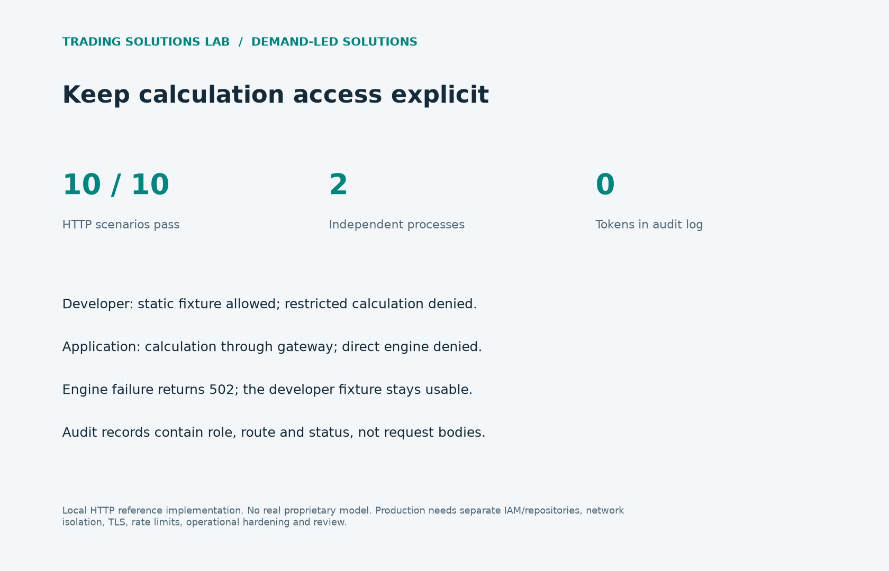

# Restricted calculation API

Separate developer integration fixtures from restricted calculation access.



## Executed result

| HTTP scenario | Expected | Observed |
|---|---:|---:|
| Developer fixture | 200 | 200 |
| Developer live route denied | 403 | 403 |
| Application live route | 200 | 200 |
| Application direct engine denied | 401 | 401 |
| Developer direct engine denied | 401 | 401 |
| Anonymous denied | 401 | 401 |
| Undeclared source route denied | 404 | 404 |
| Invalid schema rejected | 400 | 400 |
| Engine failure closed | 502 | 502 |
| Mock survives engine failure | 200 | 200 |

All ten scenarios passed. Audit logs contained no generated credentials. Both services run in separate local subprocesses. [Deployment boundary and limitations](../../solutions/calculation_boundary/README.md).

## Reproduce and adapt

```sh
python -m unittest test_demand_solutions -v
python run_demand_solutions.py --output /tmp/demand-evidence
```

[Implementation](../../solutions/calculation_boundary/) · [Design and public demand references](../../solutions/README.md) · [Results JSON](results.json) · [Standalone HTML report](report.html)

## Scope

Local HTTP example with a public placeholder formula. OS/IAM isolation, TLS and production deployment are not implemented. Original AI-assisted portfolio work; no client source, account data, or proprietary strategy is included.
