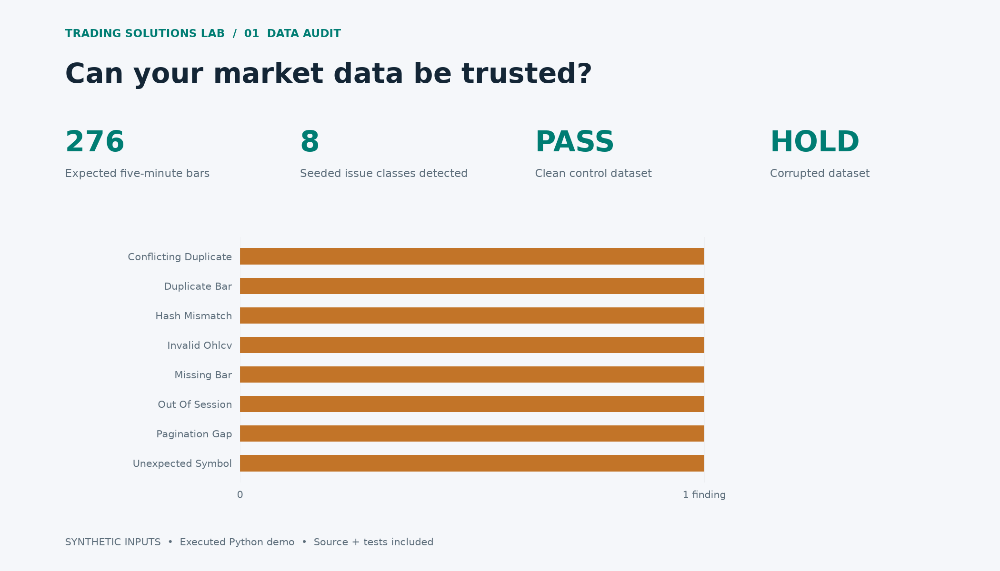

# Market Data Integrity Audit

A read-only audit detects eight seeded defect classes and preserves the original data. The clean control passes.

## Findings on the intentionally corrupted fixture

| Finding | Source | Evidence |
| --- | --- | --- |
| HASH_MISMATCH | page-00.json | Raw bytes differ from the stored SHA-256 receipt |
| INVALID_OHLCV | page-00.json#/bars/20 | Non-finite, negative, or inconsistent OHLCV |
| PAGINATION_GAP | page-02.json | Request cursor does not continue preceding response |
| OUT_OF_SESSION | page-04.json#/bars/36 | 2022-11-24T15:00:00+00:00 |
| UNEXPECTED_SYMBOL | page-04.json#/bars/37 | OTHER |
| DUPLICATE_BAR | page-04.json#/bars/35 | 2022-03-11T14:50:00+00:00 |
| CONFLICTING_DUPLICATE | page-04.json#/bars/35 | Duplicate key has different OHLCV values |
| MISSING_BAR | expected XNYS schedule | 2022-03-11T15:30:00+00:00 |

## Calendar cross-check

| Date | Expected bars | Open UTC |
| --- | --- | --- |
| 2022-03-11 | 78 | 2022-03-11T14:30:00+00:00 |
| 2022-03-14 | 78 | 2022-03-14T13:30:00+00:00 |
| 2022-11-23 | 78 | 2022-11-23T14:30:00+00:00 |
| 2022-11-24 | 0 | Closed |
| 2022-11-25 | 42 | 2022-11-25T14:30:00+00:00 |

## Scope

Fixture byte integrity, cursor continuity, XNYS schedule and OHLCV checks. Not a client audit or source-authenticity certification.

Both input fixtures and their receipt manifests are in fixtures/. Original input bytes remain unchanged during audit.

[Machine-readable results](results.json) · [Source and run instructions](../../README.md)
