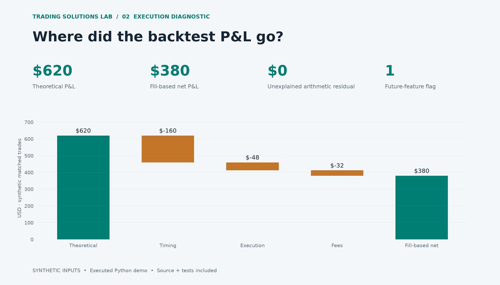

# Backtest-to-Fill Diagnostic

Reconcile theoretical and observed trade P&L, attribute the difference, and flag future-dated features. Every number below comes from the included synthetic ledger.

## Exact P&L decomposition

| Trade | Side | Theoretical | Timing | Execution | Fees | Net | Residual |
| --- | --- | --- | --- | --- | --- | --- | --- |
| T01 | LONG | 120.0 | -20.0 | -6.0 | 4.0 | 90.0 | 0.0 |
| T02 | SHORT | 80.0 | -20.0 | -6.0 | 4.0 | 50.0 | 0.0 |
| T03 | LONG | -40.0 | -20.0 | -6.0 | 4.0 | -70.0 | 0.0 |
| T04 | SHORT | 150.0 | -20.0 | -6.0 | 4.0 | 120.0 | 0.0 |
| T05 | LONG | 120.0 | -20.0 | -6.0 | 4.0 | 90.0 | 0.0 |
| T06 | SHORT | 80.0 | -20.0 | -6.0 | 4.0 | 50.0 | 0.0 |
| T07 | LONG | -40.0 | -20.0 | -6.0 | 4.0 | -70.0 | 0.0 |
| T08 | SHORT | 150.0 | -20.0 | -6.0 | 4.0 | 120.0 | 0.0 |

## Causality checks

| Trade | Finding |
| --- | --- |
| T03 | FEATURE_AFTER_SIGNAL |

## Scope

Arithmetic attribution for supplied matched trades. No profitability claim, strategy optimization, or inference about an unseen live system.

Timing is the mid-price move between signal and fill. Execution is the fill-versus-contemporaneous-mid difference; it includes spread/impact and does not distinguish them without richer data. Input ledger: input-trades.json.

[Machine-readable results](results.json) · [Source and run instructions](../../README.md)
