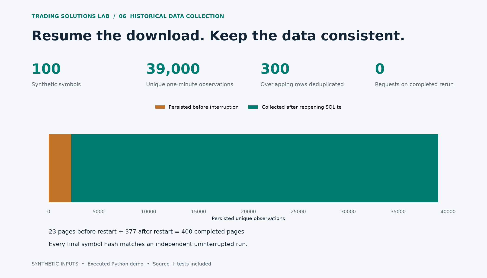

# Resumable Historical Data Collector

Collect 39,000 synthetic observations across 100 symbols, resume after interruption, remove page overlap and verify every output against an uninterrupted control run. An original offline portfolio example.



## Executed checks

| Check | Result |
| --- | --- |
| Unique observations | 39000 |
| Symbols | 100 |
| Committed pages before / after restart | 23 / 377 |
| Boundary duplicates removed | 300 |
| Injected transient errors | {'429': 6, '503': 5} |
| Recorded retry waits (simulated seconds) | 17 |
| Requests when rerun after completion | 0 |
| Matches independent clean-run hashes | True |

## Try it

```sh
python collect_history_demo.py --output /tmp/history-demo
python -m unittest test_history_collector -v
```

Only Python standard-library modules are needed for the collector. The CLI writes a result JSON containing 100 symbol manifests and sample observations; no external data is downloaded.

## What is demonstrated

An atomic SQLite transaction stores a page and advances its checkpoint together. Matching duplicates are ignored; conflicting values or gaps roll back the entire page. A bounded retry loop respects the injected retry-after value. After 23 successful pages, the database connection is closed and reopened; completed work is not requested again. Tests also exercise persistent errors, cursor loops and conflict rollback.

## First paid module

Adapt one licensed data source for an agreed symbol list, interval and time range; deliver a restartable collector, machine-readable output and a completeness report. Broker contract resolution, permissions, historical-data duration limits, pacing and calendars are adapter work. The existing [data audit](../data-audit/) illustrates complementary checks on five-minute data; its input schema differs, so these two demos are not yet an integrated production pipeline.

## Demand and attribution

An independent original demonstration inspired by the public task category of collecting one-minute history for approximately 100 symbols. A corresponding historical contract and review are visible in [this public work history](https://www.upwork.com/freelancers/~011d14bd8974209306). That contract belongs to another freelancer. No client code, data or work product was used. Actual earnings are private; this demonstration makes no historical sales claim.

## Platform reference

[IBKR historical-data documentation](https://www.interactivebrokers.com/docs/tws-api/doc/md/introduction). The synthetic provider's cursor and HTTP-like errors are not the TWS callback protocol.

## Scope

One synthetic 390-minute session, 100 synthetic symbols, one worker. A SQLite connection is closed/reopened after an injected interruption. Retry delays use a recording clock, not wall-clock sleeping. HTTP-like 429/503 events are generic test fixtures, not an IBKR protocol emulation. No broker SDK, live market data, real pacing validation or vendor authentication.

[Machine-readable results](results.json) · [Source and run instructions](../../README.md)
