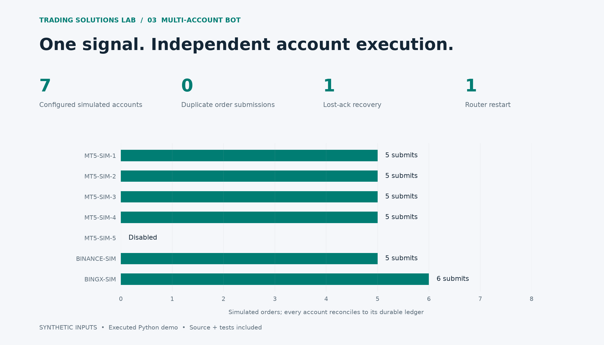

# Multi-Account Signal Execution

A closed-candle example strategy routes long/flat targets to seven simulated accounts. Failures remain isolated and order intent survives a router restart.

## Account results

| Account | Enabled | Submissions | Unique order IDs | Position | Ledger |
| --- | --- | --- | --- | --- | --- |
| MT5-SIM-1 | True | 5 | 5 | 2 | 2 |
| MT5-SIM-2 | True | 5 | 5 | 2 | 2 |
| MT5-SIM-3 | True | 5 | 5 | 2 | 2 |
| MT5-SIM-4 | True | 5 | 5 | 2 | 2 |
| MT5-SIM-5 | False | 0 | 0 | 0 | 0 |
| BINANCE-SIM | True | 5 | 5 | 2 | 2 |
| BINGX-SIM | True | 6 | 6 | 2 | 2 |

## Exercised events

| Event | Count |
| --- | --- |
| DEDUPLICATED | 31 |
| FILLED | 29 |
| HELD | 10 |
| RECOVERED | 1 |
| REJECTED | 1 |
| UNKNOWN | 1 |

## Scope

Offline one-symbol, single-worker long/flat orchestration demo. MT5/Binance/BingX labels denote simulations, not live adapters. Immediate fills at bar close exclude fees and slippage.

One account is disabled, one disconnects and reconnects, one acknowledgement is lost, and one order is rejected. The SQLite-backed router is restarted during the replay. Stops and trailing exits use closed prices, not intrabar execution.

[Machine-readable results](results.json) · [Source and run instructions](../../README.md)
