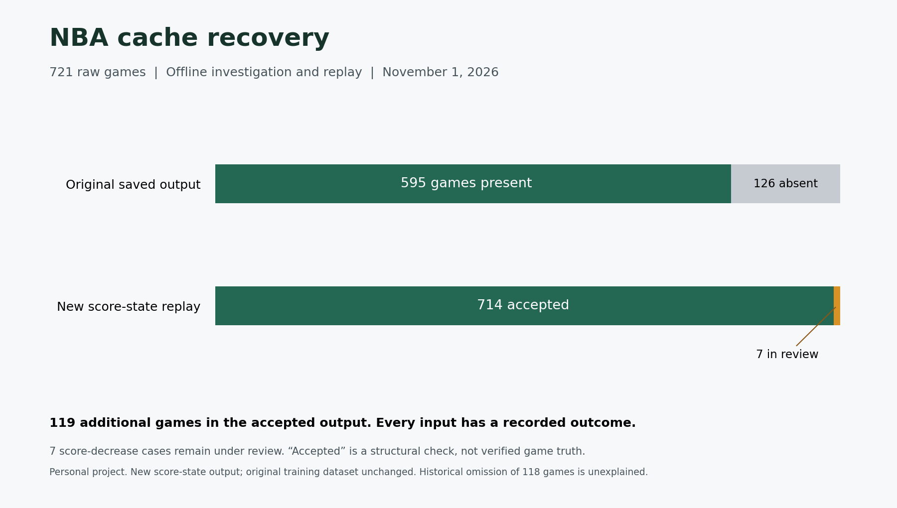

# NBA data pipeline: account for every cached game



My saved NBA output contained 595 games, although the raw folder held 721. I investigated the 126-game difference and rebuilt a separate score-state dataset from the cached V3 files.

The rebuild puts **714 games in the accepted output and 7 in a review queue**. That recovers 119 previously absent games into the new accepted output. Every input file now has a recorded outcome.

## What the investigation found

| Of the 126 absent games | Reproduced behavior | Treatment |
|---|---|---|
| 118 | Parse successfully with the current private code; the old output omitted them | Recovered by rebuilding. The historical omission cannot be explained without the old run logs or manifest. |
| 1 | A trailing empty score string causes the old game-metadata builder to fail | The new replay uses populated score pairs and handles empty non-scoring rows. |
| 7 | A score-decrease check rejects the entire game | Source score changes are retained and flagged in a separate review output. No automatic score correction or event reordering. |

The seven review games include score decreases around replay events or same-clock events. Determining the correct historical event sequence needs further source checks. They are not counted as repaired or clean data.

## What changed

The new standalone replay produces two Parquet files and a per-file manifest:

- `accepted.parquet`: 714 games / 84,176 score-state rows passing these checks.
- `needs_review.parquet`: 7 games / 847 rows, retaining the source score decreases.
- `manifest.json`: one outcome and input hash for every file, including failures.

It preserves source row order and score pairs, including valid `0` home scores. It refuses to overwrite an existing output directory. A run with review items or rejected files exits with code **2**, so a scheduler cannot report an unconditional success.

This is a **separate score-state rebuild**, not a replacement for the private model-feature dataset. The old dataset and raw files were left unchanged. The before/after game counts share the same raw inventory; row counts are not a like-for-like comparison of the two different output schemas.

## Verification

On November 1, 2026:

- All 721 inputs were accounted for; none failed to parse in the new replay.
- All 595 previously represented games remained in the accepted set; 119 were added.
- The final emitted score pair matched the last populated source pair for all 721 games, including the review set.
- All input hashes and the original processed-file hash remained unchanged.
- Five regression tests passed: zero home scores, trailing blanks, retained score decreases, malformed inputs, and deterministic replay with separate exception handling.

“Accepted” means these structural checks passed. It does not establish complete-season coverage, correct home/away team mapping, correct event ordering, or independent agreement with actual NBA results.

## Inspect or run it

[Counts and disposition of all 126 absent games](coverage-resolution.json) · [Replay code](rebuild_score_states.py) · [Regression tests](test_rebuild_score_states.py)

```sh
python -m pip install pandas pyarrow
python -m unittest discover -s reports/nba-data-check -p 'test_*.py' -v
python reports/nba-data-check/rebuild_score_states.py \
  --raw-dir /path/to/raw/season \
  --output-dir /path/to/new-score-state-output
```

Supply your own cached V3 files. Source data, private collection code, trading logic and model features are not published. The public code is a standalone replay example, with synthetic test fixtures created in the tests.

The [October 31 initial audit](results.json) and [read-only inventory checker](audit_parquet.py) remain available as the original baseline.
