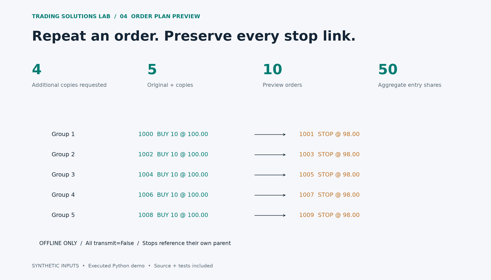

# Repeated Entry + Stop Order Preview

A runnable offline example converts four additional repeats into five independent entry/stop pairs. It validates stop direction, tick alignment and aggregate share limits before producing the plan.



## Preview result

| ID | Type | Side | Shares | Price | Parent | Transmit |
| --- | --- | --- | --- | --- | --- | --- |
| 1000 | LMT | BUY | 10 | 100.00 | 0 | False |
| 1001 | STP | SELL | 10 | 98.00 | 1000 | False |
| 1002 | LMT | BUY | 10 | 100.00 | 0 | False |
| 1003 | STP | SELL | 10 | 98.00 | 1002 | False |
| 1004 | LMT | BUY | 10 | 100.00 | 0 | False |
| 1005 | STP | SELL | 10 | 98.00 | 1004 | False |
| 1006 | LMT | BUY | 10 | 100.00 | 0 | False |
| 1007 | STP | SELL | 10 | 98.00 | 1006 | False |
| 1008 | LMT | BUY | 10 | 100.00 | 0 | False |
| 1009 | STP | SELL | 10 | 98.00 | 1008 | False |

## Try a different input

```sh
python repeat_orders.py --repeats 2 --quantity 5 --entry 100 --stop 98
```

## First milestone

Agree whether copies are concurrent or sequential and whether an external helper is acceptable. Then adapt one agreed order type to the client's paper account and verify parent/child status and cancellation. This preview is concurrent only and does not modify TWS itself.

## Integration checklist

Qualify the contract and tick size; allocate broker-valid order IDs; agree the transmit sequence; reconcile acknowledgements, partial fills and cancellations in paper trading. The preview uses synthetic local IDs and all orders remain transmit=False.

## Official API reference

[IBKR Campus: complex orders](https://www.interactivebrokers.com/campus/trading-lessons/python-complex-orders/). The demo follows the documented parentId/attached-order concept; no real SDK connection has been exercised.

## Scope

Concurrent original + copies; all transmit=False. Synthetic equity only. Stop-distance exposure excludes gaps, slippage and fees; it is not a loss cap. No TWS connection, native UI modification or sequential re-entry.

[Machine-readable results](results.json) · [Source and run instructions](../../README.md)
