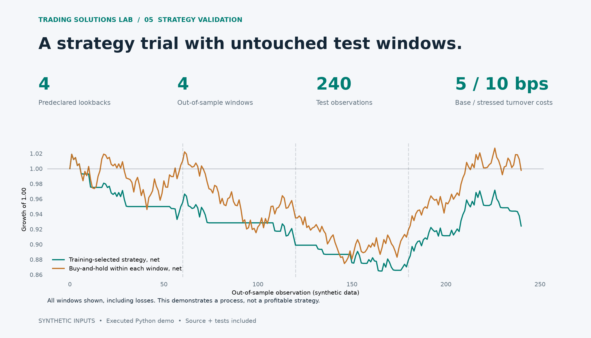

# Small Strategy Validation Trial

An executable research process: choose parameters using past data, freeze them, and report every out-of-sample result with a baseline and doubled-cost stress. Synthetic data demonstrates the pipeline; no investment performance is claimed.

## Every out-of-sample window

| Test indices | Chosen lookback | Net return | Benchmark | 10 bps stress | Max drawdown |
| --- | --- | --- | --- | --- | --- |
| 240–299 | 40 | -4.48% | 1.03% | -4.96% | -8.45% |
| 300–359 | 40 | -5.90% | -7.45% | -6.18% | -6.99% |
| 360–419 | 10 | -2.20% | -1.73% | -2.98% | -3.79% |
| 420–479 | 10 | 5.13% | 8.59% | 4.60% | -4.87% |

## Method

Four SMA lookbacks (5, 10, 20, 40) are declared before the experiment. Each expanding training window selects by net return, with deterministic ties. Parameters freeze for the next 60 observations. The final training mark precedes the test entry by one observation. Features use previous closes and the return proxy uses the next open-to-open interval. Every fold starts flat, charges turnover plus final liquidation, and reports an equally reset buy-and-hold comparator. JSON includes every candidate training score and every test return. The supplied input-bars.json is synthetic and reproducible.

## First milestone

Replace the synthetic fixture with one agreed licensed dataset and test one supplied strategy against a baseline. Deliver reproducible code, an experiment log, all fold results and a recommendation to reject, investigate or extend. NSE/BSE delivery additionally needs point-in-time universe/corporate actions, trading calendars, market-specific costs and data rights. Those are not implemented here. Multiple-testing significance and large strategy searches require a separate validation design.

## Scope

Synthetic one-asset long/flat SMA trial; 4 predeclared lookbacks. Expanding training windows, 4 non-overlapping test windows, 5 bps per unit turnover and 10 bps cost stress. Separate windows start and end flat, including the buy-and-hold comparator. Costs approximate daily returns. No market-specific taxes, dividends, universe selection, realistic fills, statistical-significance test or NSE/BSE integration. This is not evidence of alpha.

[Machine-readable results](results.json) · [Source and run instructions](../../README.md)
